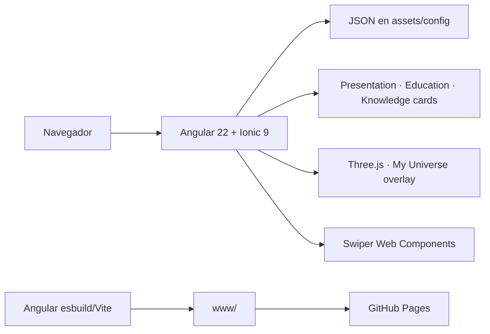

# Guía técnica de Briefcase

## Arquitectura



La aplicación es completamente estática. Angular carga la configuración mediante `HttpClient`; no existe API ni base de datos. El build de producción genera `www/` con `base-href=/briefcase.github.io/` y copia `.nojekyll` para GitHub Pages.

## Versiones del proyecto

| Herramienta | Versión fijada |
| --- | --- |
| Node.js | `26.13.0` LTS |
| npm | `11.20.0` |
| Angular | `22.2.4` |
| Angular CLI / builder | `22.2.5` |
| Ionic Angular | `9.0.10` |
| Capacitor | `8.6.0` |
| Three.js | `0.187.0` |
| Swiper | `14.4.0` |
| TypeScript | `6.0.3` |

`.nvmrc`, `.node-version`, `package.json#engines` y `packageManager` documentan el entorno esperado.

## Preparación con NVM

Antes de instalar, compilar o depurar:

```powershell
nvm list
nvm install 26.13.0 64 # sólo cuando falte
nvm use 26.13.0
node --version
npm --version
```

En este equipo, `nvm use` puede cambiar la selección sin quedar primero en el `PATH`. `run-local.ps1` y `scripts/use-node.ps1` evitan esa ambigüedad: localizan el directorio de NVM, anteponen `v26.13.0` al `PATH` del proceso e invocan su `npm.cmd` de forma explícita. No cambian la selección global de NVM.

## Ejecución local

Comando recomendado:

```powershell
.\run-local.ps1
```

Abre [http://localhost:8100](http://localhost:8100). Si `node_modules` no existe, el script ejecuta `npm ci` desde el lockfile.

| Modo | Comando | Uso |
| --- | --- | --- |
| Desarrollo | `.\run-local.ps1` | Source maps y recarga en `localhost:8100` |
| Producción local | `.\run-local.ps1 -Production` | Sirve la configuración de producción |
| Verificación | `.\run-local.ps1 -Verify` | Lint, pruebas y build |
| Red local | `.\run-local.ps1 -Network` | Escucha en `0.0.0.0:8100` |

El modo `-Network` expone el servidor de desarrollo a la red local. No debe usarse como hosting de producción.

Comandos npm equivalentes:

```powershell
npm run debug         # desarrollo en localhost:8100
npm run debug:network # desarrollo accesible por LAN
npm run debug:cli     # pausa Angular CLI en el inspector de Node
npm run preview       # configuración de producción en local
npm run build         # build estático en www/
npm run build:debug   # build con source maps
npm run deploy:pages  # build y publicación explícita en gh-pages
npm run lint
npm test
npm run verify
npm run versions
```

Para ejecutar cualquier script con la versión fijada sin iniciar la aplicación:

```powershell
.\scripts\use-node.ps1 versions
.\scripts\use-node.ps1 build
```

## Depuración en VS Code

El repositorio incluye:

- `.vscode/tasks.json`: inicia Angular con NVM y espera a que el servidor esté listo.
- `.vscode/launch.json`: abre Chrome con source maps o se adjunta a Chrome en el puerto `9222`.

En **Run and Debug**, selecciona `Briefcase: Angular + Chrome`. Para depurar el propio Angular CLI usa:

```powershell
.\scripts\use-node.ps1 debug:cli
```

## Configuración de contenido

`src/assets/config.example/` contiene el contrato público y datos ficticios. `npm run prepare:config` crea `src/assets/config/` a partir de esa plantilla únicamente cuando la carpeta local no existe. La configuración local es la fuente efectiva de contenido, permanece ignorada por Git y no debe incluirse en commits.

| Archivo | Responsabilidad |
| --- | --- |
| `site.json` | Identidad, datos personales, contacto, perfiles públicos y footer |
| `navigation.json` | Orden, etiqueta, icono y visibilidad de secciones |
| `theme.json` | Tokens de color y modo predeterminado |
| `seo.json` | Idioma, title, description, keywords, canonical, Open Graph y Twitter Card |
| `sections/presentation.json` | Tarjetas de presentación |
| `sections/education.json` | Formación, cursos, certificaciones e insignias públicas |
| `sections/knowledge.json` | Rubros, stacks, tecnologías y evidencias |

### Contrato de conocimiento

```json
{
  "name": "Front-End",
  "image": "assets/img/Skills/FrontEnd.png",
  "knowledge": [
    {
      "name": "Frameworks",
      "experience": [
        {
          "title": "ANGULAR",
          "time": "4 YEARS",
          "description": "Descripción opcional",
          "highlights": ["Evidencia breve"],
          "projects": [
            {
              "name": "Proyecto",
              "summary": "Alcance verificable",
              "url": "https://ejemplo.test"
            }
          ],
          "repositories": [
            {
              "name": "repositorio",
              "url": "https://github.com/usuario/repositorio"
            }
          ]
        }
      ]
    }
  ]
}
```

`description`, `highlights`, `projects` y `repositories` son opcionales. La interfaz oculta las secciones sin datos; no genera proyectos ni enlaces ficticios.

## Knowledge y My Universe

`KnowledgeSectionComponent` transforma cada rubro de `knowledge.json` en tarjetas verticales detalladas. Cada tarjeta admite hasta seis tecnologías; los rubros extensos se reparten automáticamente y muestran su posición (`1 / 2`, `2 / 2`). Reutiliza `SlideCardsComponent`, por lo que conserva navegación por rueda, gesto, indicadores y teclado `↑/↓`, igual que Education.

`KnowledgeComponent` crea la experiencia independiente My Universe. Se abre desde el icono animado de mundo-red del header y se presenta en un overlay, fuera del carrusel de las tres secciones. La escena Three.js incluye:

- núcleo solar procedural, animado y clicable, con pequeñas llamaradas y pulso periódico, que navega a Presentation;
- una órbita continua con brillo y cinturón de asteroides, sin satélites propios, que navega a Education;
- seis órbitas exteriores 3D, finas y punteadas: una por dominio Knowledge, sin líneas radiales desde el núcleo;
- capas radiales separadas para que los sistemas no colisionen;
- sistemas anidados donde clusters y tecnologías orbitan a su padre conservando separación angular;
- etiquetas centradas dentro de cada nodo y glow radial aditivo con pulso irregular;
- rotación independiente del núcleo, cinturón y red Knowledge;
- una capa ambiental fija a cámara y detrás del sistema, con cometa, asteroide irregular y estrella fugaz que reciben rutas diagonales y tiempos nuevos en cada aparición;
- un púlsar no interactivo, independiente de la rotación, que aparece una sola vez entre los minutos 15 y 30 de vista general;
- `OrbitControls` sólo para rotación; el zoom libre se mantiene deshabilitado para preservar la composición;
- raycasting para hover luminoso y selección con cursor de mano;
- cuatro niveles derivados de la distancia de cámara: `system`, `orbit`, `cluster` y `node`;
- panel de evidencia para tiempo, descripción, proyectos y repositorios;
- controles Pause/Resume y acción `Explore`; esta última detiene el movimiento, centra el sistema y mantiene el panel con el detalle completo;
- `ResizeObserver`, límite de pixel ratio y liberación de recursos WebGL.

Las posiciones expresan jerarquía, no geografía. Los dominios se distribuyen en órbitas externas y sus hijos forman pequeños sistemas locales alrededor de cada padre.

## Shell visual y navegación

### Entrada cinemática

`PortfolioIntroComponent` sustituye una espera genérica por una presentación semántica del producto. La animación se monta sobre el shell ya inicializado, dura un máximo de 5 segundos y se retira tanto por `animationend` como mediante un temporizador de respaldo.

La secuencia representa el sistema solar profesional: enciende un núcleo solar, forma un cinturón de asteroides y pone tres planetas en movimiento antes de revelar la interfaz. No representa un porcentaje de descarga.

- La clave de sesión `briefcase.portfolio-intro.v1` evita repetirla durante la misma pestaña.
- El parámetro `?intro=1` fuerza una repetición para demostración y QA.
- `prefers-reduced-motion: reduce` impide que el componente se renderice.
- La lógica de decisión permanece aislada en `portfolio-intro.utils.ts` y cubierta por pruebas unitarias.
- Header, contenido y footer se revelan de forma coordinada sin condicionar la carga de JSON ni la navegación.

### SEO estático y vista previa social

Angular conserva `SeoService` para aplicar los metadatos en runtime. Además, el `postbuild` ejecuta `scripts/inject-seo.mjs`, lee el `assets/config/seo.json` efectivo y reemplaza el bloque marcado en `www/browser/index.html`. Así, crawlers que no ejecutan JavaScript reciben desde el primer HTML:

- title, description y keywords;
- canonical absoluto;
- Open Graph con URL segura, formato, dimensiones y texto alternativo;
- Twitter Card de imagen grande.

Las rutas relativas de imagen se resuelven contra `canonicalUrl`. La vista previa pública usa `assets/img/social.jpg` en 1200 × 630; la configuración local puede sustituir título, descripción, canonical e imagen sin publicar identidad en `main`.

- `HeaderComponent` presenta logo, nombre, profesión, contacto y selector de tema. En móvil conserva la identidad y compacta los enlaces sociales en un menú.
- El acceso `My Universe` del header es independiente de la navegación de secciones; en móvil conserva el icono y oculta sólo su etiqueta.
- `HomePage` controla la sección activa y sincroniza pestañas, swipe, flechas y teclado con la instancia principal de Swiper. `←/→` cambia de sección con fade y `↑/↓` recorre las tarjetas verticales activas.
- `SlideCardsComponent` reserva la paginación vertical sólo para tarjetas internas; sus indicadores son puntos circulares y no reutilizan los controles de sección.
- `FooterComponent` mantiene una firma visual en todos los tamaños y obtiene el nombre y enlace desde `site.json`.
- El activo de marca se configura mediante `personalFiles.avatarPath`. Los retratos y logos personales deben permanecer ignorados por Git; `avatar.svg` funciona como recurso ficticio para forks.

## Estructura relevante

- `src/app/components/knowledge-section/`: tarjetas detalladas de la sección Knowledge.
- `src/app/components/knowledge/`: escena My Universe, controles y ficha de detalle.
- `src/app/services/portfolio-navigation.service.ts`: navegación desde My Universe hacia las secciones principales.
- `src/app/services/language.service.ts`: diccionario EN/ES, inglés predeterminado y persistencia `briefcase-language`.
- `src/app/pipes/translate.pipe.ts`: traducción reactiva de plantillas.
- `src/app/services/data.service.ts`: carga tipada de JSON.
- `src/app/services/theme.service.ts`: aplica paletas y persistencia local del tema.
- `src/app/services/seo.service.ts`: actualiza title, meta y canonical en runtime.
- `src/app/interface/`: contratos TypeScript de configuración.
- `src/assets/config.example/`: configuración pública ficticia y reutilizable.
- `src/assets/config/`: contenido local efectivo, ignorado por Git.
- `src/assets/img/SkillsTransparent/`: copias alfa de los iconos Knowledge; el color de fondo pertenece al CSS del tema.
- `scripts/remove-image-background.ps1`: regenera las copias transparentes sin modificar los PNG originales.
- `scripts/copy-nojekyll.mjs`: copia portable de `.nojekyll`.
- `scripts/use-node.ps1`: ejecución de scripts con el Node fijado.
- `run-local.ps1`: entrada local recomendada.

## Build y GitHub Pages

```powershell
.\scripts\use-node.ps1 build
```

Angular 22 genera el sitio navegable en `www/browser/`; `www/` es sólo el contenedor del builder. El repositorio usa este contrato de ramas:

| Rama | Responsabilidad |
| --- | --- |
| `main` | Fuente completa, documentación, scripts, pruebas y JSON ficticio de `src/assets/config.example/` |
| `gh-pages` | Artefacto estático generado desde `www/`; incluye la configuración local publicada como `assets/config/` |

`gh-pages` no se modifica manualmente. Sus JSON son copias del build personalizado y no deben copiarse de regreso a `main`. Para publicar manualmente con la configuración local existente:

```powershell
npm run deploy:pages
```

El script ejecuta primero el build y después copia `www/browser/` a un worktree temporal basado en `origin/gh-pages`. La publicación crea un commit generado y modifica la rama remota de hosting; debe ejecutarse sólo con autorización explícita. Un build local no demuestra que GitHub Pages haya sido actualizado.

## Validación

Separar siempre los resultados:

1. `npm run lint`: reglas estáticas de TypeScript y plantillas.
2. `npm test`: pruebas unitarias sin modo watch.
3. `npm run build`: compilación de producción y assets.
4. Browser QA: interacción real, WebGL, rotación, navegación por niveles, touch y enlaces.
5. Verificación pública: sólo después de publicar y comprobar la URL remota.

## Límites conocidos

- Requiere WebGL en el navegador.
- El contenido se carga en runtime desde JSON; no existe CMS.
- Los metadatos dinámicos dependen de ejecutar JavaScript.
- Capacitor está configurado, pero este repositorio no contiene proyectos nativos Android/iOS.
- La validación local no equivale a una publicación en GitHub Pages.
