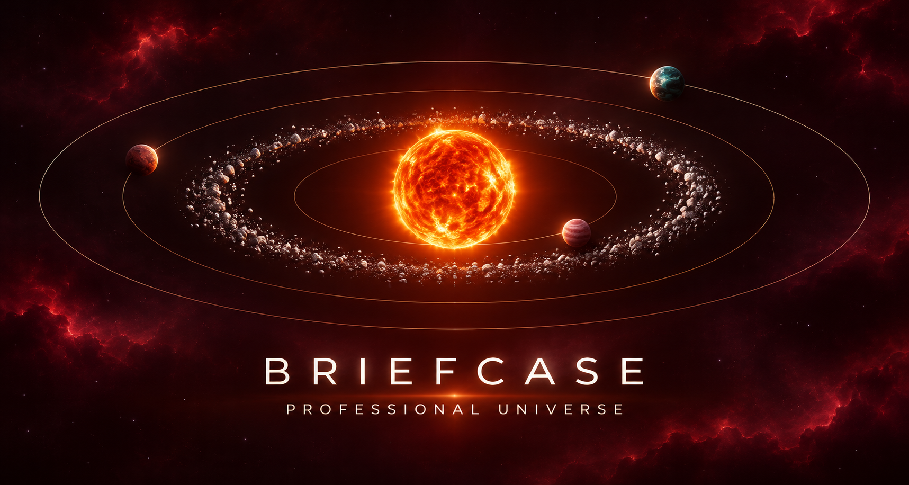

# Briefcase · Portfolio & My Universe

Briefcase is a configurable portfolio and technical showcase that presents professional experience, education and knowledge through three detailed sections: Presentation, Education and Knowledge. Its independent **My Universe** experience transforms the same content into a professional solar system: Presentation is the solar core, Education is a continuous asteroid belt, and Knowledge forms an outer network of domains, clusters and technology nodes.

The project is a static Angular application designed for GitHub Pages. Content lives in JSON files, so copy and evidence can be updated without recompiling individual UI components.



## Engineering highlights

- Angular 22 and Ionic 9 on Node.js 26 LTS.
- A cinematic solar-system entrance that plays once per browser session and respects reduced-motion preferences.
- An independent Three.js WebGL system with manual rotation, 3D orbits, an education belt, illuminated hover states and semantic exploration levels.
- Camera-independent environmental events with randomized asteroids, comets and shooting stars, plus a one-time pulsar easter egg.
- Responsive desktop, mobile, wheel, touch and keyboard navigation.
- Direct navigation between Presentation, Education and Knowledge with accessible controls and visible state.
- Configurable identity across the presentation, header and permanent footer watermark.
- Light and dark themes, bilingual EN/ES content and persistent language preference.
- Build-time SEO injection for crawler-readable Open Graph, Twitter Card and canonical metadata.
- A reproducible static GitHub Pages deployment.
- NVM scripts and VS Code debugging configuration.

## My Universe

The rotating network-world icon in the header opens My Universe as an overlay without turning it into a fourth portfolio section. Closing the experience returns to the previously active section.

The visualization uses four semantic levels:

1. **System** shows the solar core, Education belt and outer Knowledge network.
2. **Orbit** focuses Education or a professional domain.
3. **Cluster** reveals stacks and practice areas within a domain.
4. **Node** presents a technology's experience and, when configured, its projects and repositories.

Presentation and Education can return to their portfolio sections through a fade transition. Education is represented by one complete luminous belt with no satellites of its own. Every Knowledge domain has its own 3D orbit, color and additive glow; clusters orbit their domain and technologies orbit their cluster. Radial separation keeps the systems readable and prevents collisions.

The core uses a procedural solar surface, glow and periodic pulses. Environmental events remain fixed to the camera background, never rotate with the professional map and appear only in the system view. The pulsar is an eight-second easter egg that appears once after a random 15-to-30-minute delay.

Pause/Resume controls the orbital system. Selecting an element focuses it, keeps the relevant detail panel open and uses semantic navigation instead of unrestricted wheel zoom.

## Navigation and cinematic entrance

The top tabs switch directly between the three portfolio sections, while the side arrows move through them in order. In Education and Knowledge, the mouse wheel, vertical gesture, `↑/↓` keys and dot indicator navigate internal cards without conflicting with section navigation. Knowledge automatically splits large domains into cards of up to six technologies.

On the first visit of each browser session, Briefcase presents a short solar-system ignition: the sun appears, the asteroid belt forms and planets enter their orbits before the application shell is revealed. It is a presentation layer rather than a download indicator and does not delay Angular initialization. It is skipped when `prefers-reduced-motion` is active and can be replayed with `?intro=1`.

## Run locally

NVM for Windows is required. The project pins Node.js **26.13.0** in `.nvmrc`.

```powershell
git clone https://github.com/Alfonso-13/briefcase.github.io.git
cd briefcase.github.io
nvm list
nvm install 26.13.0 64   # Only when the version is not installed yet.
.\run-local.ps1
```

The script selects the version from `.nvmrc`, resolves the matching executable even when `PATH` still points to another Node version, installs missing dependencies and serves the application at [http://localhost:8100](http://localhost:8100).

Additional modes:

```powershell
.\run-local.ps1 -Production # Local server with production configuration.
.\run-local.ps1 -Verify     # Lint, tests and production build.
.\run-local.ps1 -Network    # Access from other devices on the network.
```

## Configure the portfolio

Reusable fictional configuration lives in `src/assets/config.example/`. On first run, `npm run prepare:config` copies it to `src/assets/config/` only when local configuration does not exist. The generated folder is ignored by Git so personal identity and professional data are not committed accidentally.

Local configuration files:

- `site.json`: identity, contact links, public profiles and footer.
- `navigation.json`: visible sections and ordering.
- `theme.json`: color palettes and default mode.
- `seo.json`: language, title, description, keywords, canonical URL, Open Graph image and accessible image text.
- `sections/`: presentation, education and knowledge content.

During a production build, `scripts/inject-seo.mjs` reads the effective `seo.json` and writes crawler-readable metadata directly into the generated `index.html`. Relative image paths are converted to absolute URLs from the canonical address. Angular applies the same values at runtime.

Education links only to configured public profiles such as LinkedIn Certifications, Skillsoft, HackerRank, Udemy and Codewars. Résumé PDFs and private identity assets are not published with the reusable source.

Original Knowledge icons live in `src/assets/img/Skills/`; transparent themed copies live in `src/assets/img/SkillsTransparent/`. Personal portraits and brand files must remain outside Git.

Architecture, JSON contracts, debugging, build and deployment details are documented in [DEV.md](DEV.md).

## Branch model and deployment

| Branch | Responsibility |
| --- | --- |
| `main` | Source code, documentation, tests, scripts and fictional `config.example` data. It does not contain local identity configuration. |
| `gh-pages` | Generated `www/browser/` artifact, including the local configuration selected for publication. It is never edited manually. |

Validate and publish explicitly:

```powershell
npm run verify
npm run deploy:pages
```

`deploy:pages` builds the application and publishes `www/browser/` through a temporary Git worktree. A successful local build does not prove that GitHub Pages has been updated; the public URL must be verified independently.

## Scope

Briefcase is a static portfolio. It has no backend, authentication or remote persistence. Projects and repositories appear only when configured; the application never invents missing evidence.

## License

Source code is distributed under the [MIT License](LICENSE). Personal identity, biographies, résumés, photographs, logos and professional records are excluded from that reusable grant and must be replaced in any fork. See [ASSETS-LICENSE.md](ASSETS-LICENSE.md) for asset and content boundaries.

<details>
<summary><strong>Resumen en español</strong></summary>

Briefcase es un portafolio configurable construido con Angular, Ionic y Three.js. Presenta experiencia, educación y conocimientos en secciones tradicionales y en **My Universe**, un sistema solar interactivo donde Presentation es el núcleo, Education es un cinturón y Knowledge se organiza en dominios, clusters y tecnologías.

El contenido personal se mantiene en una configuración local ignorada por Git, mientras `main` conserva una plantilla ficticia reutilizable. El build inyecta SEO estático, Open Graph, Twitter Card y canonical desde `seo.json`; `gh-pages` contiene únicamente el artefacto publicado.

Para ejecutar localmente usa Node.js 26.13.0 mediante NVM y `.\run-local.ps1`. Para validar y publicar utiliza `npm run verify` y `npm run deploy:pages`.

</details>
